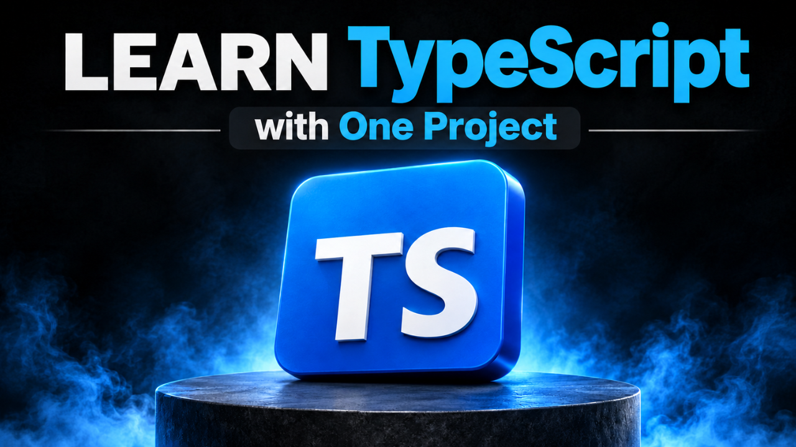

# 🚀 Build a Shopping Cart with React & TypeScript | Learn TypeScript with One Project


## Overview

Learned the basics of TypeScript and not sure what to build next? This project takes you from knowing TypeScript to actually using it.

You will build a complete, fully typed shopping cart from scratch with React, TypeScript, Context API, and `useReducer`. Every part of the app is typed, from the products and cart actions to the data saved in local storage, so you practice real type safety in a real project.

## What You'll Learn

- How to model real data with TypeScript `interface` and `type` definitions
- How to write a type-safe cart reducer using a union of action types
- How to share global state with the Context API and `useReducer`
- How to type React components, props, and context values
- How to read and validate data from `localStorage` safely at runtime
- How to use `unknown` and type checks instead of trusting untyped data
- How to type Context, `Dispatch`, and `ReactNode` correctly
- How array methods (`map`, `filter`, `findIndex`, `reduce`) work with typed data
- How to avoid prop drilling by using Context
- How to set up client-side routing with React Router
- How to structure a TypeScript React project with a clean folder layout
- How to style the app quickly with Tailwind CSS

## Who This Is For

- Developers who have learned the basics of TypeScript and want a real project to apply them
- React developers who want to move from JavaScript to TypeScript
- Anyone who wants a portfolio-ready project that shows real TypeScript skills
- Learners who understand types, interfaces, and basic React and want to see them working together

> **Note:** This is not a TypeScript-from-zero tutorial. Basic TypeScript and React knowledge will help you follow along comfortably.

## Key Features

- Add to Cart with real-time updates
- Increase and decrease quantity controls (the quantity never drops below one)
- Remove items with a delete button
- Order summary with:
  - Subtotal calculation
  - Estimated shipping
  - Total payment
- Cart badge in the header showing the total number of items
- "Proceed to Checkout" button with an "Order placed successfully" message that disappears after 5 seconds
- Empty cart state with a "Start Shopping" button that returns to the home page
- Product catalog with 12 products rendered from typed static data
- Cart saved to `localStorage`, so it survives a page refresh
- Safe loading of saved data, with validation that rejects corrupted or invalid entries
- Client-side routing between the products page and the cart page, with no page reload
- Modern UI styled with Tailwind CSS

## Technologies Used

- **React** – Core library for building the interactive UI
- **TypeScript** – Static typing for products, cart items, state, actions, and storage
- **Vite** – Fast project setup and development server
- **Context API & `useReducer`** – Global cart state and cart actions
- **React Router** – Navigation between pages without reloading
- **Local Storage** – Saving the cart between visits
- **Tailwind CSS** – Utility-first styling

## Core Types

The whole project is built on a small set of types:

```ts
export interface Product {
  id: number;
  name: string;
  price: number;
  image: string;
  description: string;
}

export interface CartItem {
  product: Product;
  quantity: number;
}

export interface CartState {
  items: CartItem[];
}

export type CartAction =
  | { type: "ADD_TO_CART"; payload: Product }
  | { type: "INCREMENT_QUANTITY"; payload: number }
  | { type: "DECREMENT_QUANTITY"; payload: number }
  | { type: "REMOVE_FROM_CART"; payload: number };
```

## How the Cart Works

1. A user clicks a button, such as Add to Cart, plus, minus, or delete.
2. The component sends a typed action with `dispatch`.
3. The cart reducer handles the action and returns a new state.
4. Every component that reads the cart updates automatically through Context.
5. The updated cart is saved to local storage.

## Project Structure

```
src/
├── components/
│   ├── Header.tsx
│   ├── ProductCard.tsx
│   └── ProductList.tsx
├── context/
│   ├── CartContext.tsx
│   └── CartReducer.ts
├── data/
│   └── products.ts
├── pages/
│   ├── Cart.tsx
│   └── Products.tsx
├── types/
│   └── model.ts
├── utils/
│   └── cartStorage.ts
├── App.tsx
└── main.tsx
```

## Getting Started

1. Clone the repository:

   ```bash
   git clone YOUR_REPOSITORY_URL
   cd YOUR_PROJECT_FOLDER
   ```

2. Install the dependencies:

   ```bash
   npm install
   ```

   > If you see a dependency conflict error, run `npm install --force`.

3. Start the development server:

   ```bash
   npm run dev
   ```

4. Open `http://localhost:5173` in your browser.

## 📽 Watch the Tutorial

🎥 YouTube: https://youtu.be/z-cDxBAWPG0

## 🌐 Live Preview

🔗 Netlify: https://velora-typescript.netlify.app/

## 👨‍💻 Author

**Frontend Mastery**
GitHub: [frontend-mastery12](https://github.com/frontend-mastery12)

---

⭐ If this project helped you, give the repository a star and subscribe to the channel for more projects.
